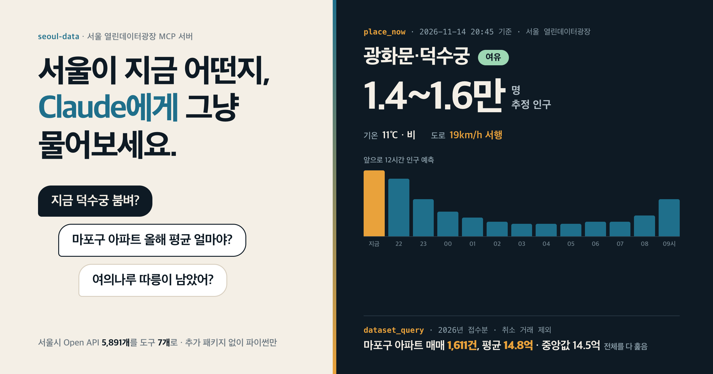

# seoul-data



> "지금 성수동 붐벼?", "마포구 아파트 올해 평균 얼마야?"라고 Claude에게 물으면 서울시 공공데이터로 답합니다.

[](LICENSE)

서울 열린데이터광장(data.seoul.go.kr)은 Open API 5,891개를 공개하고 있습니다. 하지만 하나를 쓰려 해도 데이터셋마다 서비스명과 인자 순서를 명세 화면에서 일일이 찾아야 합니다. seoul-data는 이 과정을 도구 7개로 줄인 MCP 서버입니다.

---

## 이렇게 물으면 됩니다

| 질문 | 필요한 인증키 |
|---|---|
| 지금 성수동 붐벼? 홍대, 강남역과 비교해 줘 | 일반 |
| 덕수궁 근처 공영주차장에 자리 있어? | 일반 |
| 여의나루 근처 따릉이 남았어? | 일반 |
| 마포구 올해 아파트 매매 평균과 건수 알려 줘 | 일반 |
| 지금 미세먼지가 가장 나쁜 구는 어디야? | 일반 |
| 강남역 2호선 다음 열차 언제 와? | 실시간 지하철 |
| 서울시에 무더위쉼터 데이터 있어? | 없어도 됨 |

## 설치

Claude나 Codex에게 이 저장소 주소를 주고 설치를 부탁하면 됩니다.

```
https://github.com/airoasting/seoul-data 설치해 줘
```

설치가 끝나면 앱을 다시 켜고 "서울 데이터 인증키 상태 알려 줘"라고 물어봅니다. "체험 모드"라는 답이 오면 연결된 것입니다. 준비물은 파이썬 3.9 이상뿐이며, 별도로 설치할 패키지는 없습니다.

<details>
<summary>직접 설치하려면</summary>

Claude Code 플러그인으로 설치합니다.

```
/plugin marketplace add airoasting/skills
```

```
/plugin install seoul-data@airoasting
```

또는 저장소를 내려받은 뒤 MCP 서버만 등록합니다. 경로는 내려받은 위치에 맞게 바꿉니다.

```bash
git clone https://github.com/airoasting/seoul-data.git
```

```bash
claude mcp add seoul-data -- python3 "/내려받은/위치/seoul-data/assets/mcp_server.py"
```

Claude 데스크톱 앱과 Codex는 설정 파일에 같은 명령(`python3`, `assets/mcp_server.py`의 전체 경로)을 MCP 서버로 등록하면 됩니다.

</details>

## 인증키 받기 (무료, 약 5분)

인증키가 없어도 체험 모드로 쓸 수 있습니다. 다만 체험 모드에서는 장소는 광화문·덕수궁 한 곳, 그 밖의 데이터는 처음 5행만 보입니다. 서울 전역의 데이터를 보려면 무료 인증키를 받으세요.

### 1. 서울시 통합회원으로 로그인합니다

열린데이터광장은 서울시 누리집과 같은 계정을 씁니다. 계정이 없다면 [서울시 회원가입](https://www.seoul.go.kr/member/join/regist01.do)에서 먼저 만듭니다.

### 2. 일반 인증키를 신청합니다

[Open API 이용안내](https://data.seoul.go.kr/together/guide/useGuide.do) 페이지에서 **일반 인증키 신청** 버튼을 누릅니다. 신청서에는 사용 환경과 활용 목적을 적는 칸이 있습니다. 개인적으로 쓴다면 활용 목적에 "Claude로 서울시 공공데이터 조회"처럼 한 줄만 적어도 충분합니다. 신청하면 영문과 숫자로 된 인증키가 발급됩니다.

이 키 하나로 실시간 지하철 도착 정보를 제외한 모든 기능을 쓸 수 있습니다.

### 3. (선택) 실시간 지하철 인증키를 신청합니다

지하철 도착 정보까지 쓰려면 같은 페이지의 **실시간 지하철 인증키 신청** 버튼으로 키를 하나 더 받습니다. 일반 인증키로는 지하철 API를 쓸 수 없습니다. 이 키는 하루 1,000건까지 호출할 수 있습니다.

지하철 키가 없어도 강남역, 서울역처럼 주요 장소 121곳 주변 역의 도착 정보는 일반 키로 볼 수 있습니다.

### 4. 키를 넣습니다

Claude에게 키를 알려 주면 됩니다.

```
서울 데이터 인증키 넣어 줘. 일반 키는 ○○○○, 지하철 키는 ○○○○야.
```

Claude가 실제로 한 번 호출해 키가 맞는지 확인한 뒤 저장하고, 바로 적용합니다. 키를 대화 기록에 남기고 싶지 않다면 터미널에서 아래 명령을 실행합니다. 입력한 키는 화면에 표시되지 않습니다.

```bash
python3 "/내려받은/위치/seoul-data/assets/mcp_server.py" --setup
```

키는 내 컴퓨터의 `~/.config/seoul-data/.env`에 나만 읽을 수 있는 권한으로 저장됩니다. 환경변수 `SEOUL_API_KEY`(또는 `SEOUL_OPENAPI_KEY`)와 `SEOUL_SUBWAY_API_KEY`가 이미 있다면 그 값을 그대로 씁니다.

> 열린데이터광장 안내에 따르면, 인증키를 제약 없이 계속 쓰려면 활용사례(갤러리)에 인증키와 함께 콘텐츠를 등록해야 합니다. 사용량이 많아지면 확인해 보세요.

## 도구 7개

| 도구 | 하는 일 |
|---|---|
| `place_now` | 서울 주요 장소 121곳의 현재 상황. 혼잡도와 추정 인구(12시간 예측), 날씨와 미세먼지, 도로 속도와 사고, 행사, 주차, 지하철, 버스, 따릉이, 상권, 전기차 충전소. 최대 5곳까지 한 번에 비교 |
| `subway_arrivals` | 역 하나의 실시간 도착 열차. 호선과 방향으로 좁혀 보기 |
| `bike_stations` | 따릉이 대여소를 이름이나 좌표로 찾아 대여 가능한 자전거 수 확인. 가까운 순으로 정렬 |
| `dataset_search` | 데이터셋을 한글 키워드로 검색. 검색어 없이 부르면 대표 데이터셋 10건 |
| `dataset_describe` | 데이터셋의 필터와 출력 필드를 한글 설명, 실제 예시 행과 함께 보기 |
| `dataset_query` | 데이터 조회. 범위 조건(`where`), 정렬(`sort`), 집계(`group_by`, `metrics`) 지원 |
| `key_setup` | 인증키 상태 확인과 저장 |

범용 도구(`dataset_*`) 세 개는 Open API 데이터셋 전반을 다루고(무작위 60건 표본 중 57건 성공), 전용 도구 세 개는 범용 도구로는 답이 틀리거나 쓸 수 없는 경우만 맡습니다. 장소 이름을 공식 명칭에 맞춰야 하고 응답이 6만~16만 자에 이르는 실시간 도시데이터, 서버 주소와 인증키가 다르고 하루 호출 한도가 있는 지하철, 대여소 2,739곳을 모두 받아 거리순으로 정렬해야 하는 따릉이가 그렇습니다.

### 응답 형식

```json
{
  "meta": {"dataset": "OA-21275", "total": 3831, "scanned": 3831, "matched": 1612, "scan_complete": true,
           "filters_checked": {"RCPT_YR": "반영됨", "CGG_NM": "반영됨"}},
  "notices": ["사용자에게 전해야 할 내용이 문장으로 들어갑니다"],
  "fields": {"THING_AMT": "물건금액(만원)"},
  "rows": [{"count": 1612, "avg_THING_AMT": 147987.66, "median_THING_AMT": 145000.0}]
}
```

- `notices`: 일부만 훑었다, 필터가 반영되지 않은 것 같다, 응답을 줄였다, 장소 이름을 이렇게 해석했다 같은 사실을 문장으로 알립니다.
- `fields`: 원본 필드명과 값은 그대로 두고, 의미와 단위는 서울시 명세의 한글 설명을 붙입니다.
- `meta.filters_checked`: 지정한 필터가 결과에 실제로 반영됐는지 받은 행 전체를 확인한 결과입니다.
- 오류는 `{"error": {"code", "message", "next"}}` 형식이며, `next`에 다음에 할 일이 들어 있습니다.

## 믿을 수 있나

**틀린 답을 정상인 것처럼 돌려주지 않는 것**을 가장 중요하게 여겼습니다.

- 체험 모드에서 성수동을 물으면 서울시 서버는 광화문 데이터를 돌려줍니다. seoul-data는 이를 답으로 넘기지 않고 오류로 알립니다.
- 서울시 API는 필터 값이 틀려도 오류 없이 다른 조건의 결과를 돌려줄 때가 있습니다. 받은 행 전체를 확인해 필터가 반영되지 않았으면 알립니다.
- "양천"이 글자가 겹친다는 이유로 "안양천"으로 해석되지 않습니다. 장소 이름이 하나로 좁혀지지 않으면 후보를 보여 주고, 다르게 해석했다면 그 사실을 알립니다.
- 서울시 명세의 오류는 바로잡아 알립니다. 예를 들어 주차장의 `CUR_PRK_CNT`는 명세에 "주차 가능 면수"로 적혀 있지만 실제 값은 주차된 차량 수입니다.
- 집계할 때 전체를 다 보지 못했다면 `scan_complete: false`와 함께 어디까지 봤는지 알립니다.
- 서울시 서버는 일부 데이터를 여러 번에 나눠 받을 때 페이지마다 행 순서를 바꿔 보냅니다. 그대로 이어 붙이면 같은 행이 중복되고 그만큼 다른 행이 빠져, 같은 집계도 호출할 때마다 결과가 달라집니다. seoul-data는 중복을 감지해 다시 받아 맞추고, 끝내 맞추지 못하면 빠진 행의 수와 비율을 알립니다(5% 이하면 어림값, 그 이상이면 신뢰하기 어려운 값).
- 날짜는 `2026-11-14`, `20261114`, `2026.11.14`처럼 표기가 달라도 같은 날짜로 비교합니다.
- 응답은 4만 자를 넘지 않습니다. 넘으면 내용을 줄이고 그 사실과 나머지를 받는 방법을 알립니다.

### 검증 결과 (2026-11-15)

| 항목 | 방법 | 결과 |
|---|---|---|
| 파서, URL 조립, 이어 받기, 집계, 오류 처리, 프로토콜 | 실제 응답 픽스처와 가짜 서버로 단위 테스트 (파이썬 3.9, 3.14) | 146건 통과 |
| 같은 집계의 재현성 | 마포구, 강남구, 서초구 아파트 집계를 실제 인증키로 세 번씩 호출 | 모두 같은 값, 전체 확인 |
| 도구 7개의 실제 호출 | 실제 인증키로 `--selftest` | 17건 통과 |
| 장소 121곳의 이름 | 실제 인증키로 121곳 전체 호출 | 121곳 일치 |
| 지하철 도착 | 실제 지하철 인증키로 서울역(GTX-A 포함), 천호, 이수, 왕십리, 잠실과 잘못된 역 이름 호출 | 들어오는 열차가 맨 앞, 호선·방향 필터 동작, 잘못된 이름은 비슷한 역 제안 |
| 범용 도구의 적용 범위 | Open API 데이터셋 무작위 60건을 명세 확인부터 호출까지 | 명세 60/60, 행 수신 57/60 |

행을 받지 못한 3건은 서울시 서버를 직접 호출해도 같은 오류(ERROR-500)가 났습니다. 자세한 내용은 [references/coverage.md](references/coverage.md)에 있습니다.

## 한계

- **통계 데이터셋 1,780건은 지원하지 않습니다.** 서울시가 시트와 차트로만 제공하고 Open API가 없기 때문입니다. 검색 결과에서 제외하고, 그 사실과 열람 주소를 알려 줍니다.
- **집계는 한 번에 10,000행**을 훑고, `scan`으로 50,000행까지 늘릴 수 있습니다. 다만 한 번의 호출은 20초 안에 끝나야 하므로, 열이 많은 데이터는 3만 행 안팎에서 멈추고 어디까지 봤는지 알립니다.
- **2만 행이 넘는 데이터의 집계는 어림값일 수 있습니다.** 행 순서가 바뀌는 데이터는 여러 번 받아야 맞출 수 있는데, 20초 안에 다 맞추지 못하면 빠진 행의 비율(종로구 음식점 20,613행 기준 1~5%)을 알리고 어림값으로 답합니다.
- **`place_now`는 서울시가 지정한 121곳만 지원합니다.** 자치구나 임의의 동네 단위는 없습니다.
- **인구 값은 20~30분 전 기준인 경우가 많습니다.** 응답에 기준 시각을 함께 싣습니다.
- **평문 HTTP로 통신합니다.** 서울시 API 서버가 HTTPS를 지원하지 않아 인증키가 암호화되지 않은 채 전송됩니다. 공용 와이파이에서는 주의하세요.
- **지하철역 이름은 실시간 API의 표기에 맞춰 바꿔 부릅니다.** 끝의 "역"을 떼고, "이수", "홍대", "천호"처럼 줄여 부르는 이름은 공식 이름(총신대입구(이수), 홍대입구, 천호(풍납토성))으로 바꿉니다. 맞는 이름을 찾지 못하면 비슷한 역 이름을 제안합니다.
- **서비스명과 인자 순서를 알려 주는 공식 API가 없어 명세 화면을 읽습니다.** 사이트 구조가 바뀌면 범용 도구 3개가 영향을 받으며, 이때는 `--selftest`가 먼저 알려 줍니다.

## 개발자용

```bash
python3 assets/mcp_server.py --list
```

```bash
python3 assets/mcp_server.py --call place_now '{"place": "덕수궁"}'
```

```bash
python3 assets/mcp_server.py --selftest
```

```bash
python3 -m unittest discover -s tests
```

```
seoul-data/
├── .claude-plugin/plugin.json   플러그인 등록
├── SKILL.md                     Claude가 언제 어떤 도구를 쓸지
├── DESIGN.md                    설계 근거와 검토 기록
├── assets/
│   ├── mcp_server.py            도구 7개, JSON-RPC, CLI
│   ├── seoul_client.py          URL 조립, 응답 파서, 캐시, 인증키
│   ├── catalog.py               검색 화면과 명세 화면 파서
│   ├── places.py                장소 121곳과 이름 해석
│   ├── stations.py              실시간 지하철 API의 역 이름 561개
│   └── thumbnail.html, .png
├── references/
│   ├── api-notes.md             서울시 API 실측 노트와 재현 명령
│   └── coverage.md              적용 범위 측정 결과
└── tests/
    ├── test_seoul_data.py       단위 테스트
    ├── coverage_probe.py        적용 범위 측정 스크립트
    └── fixtures/                실제 응답 18종
```

## 버전 기록

### 1.0.0 (2026-11-15)

첫 정식 버전입니다.

- 도구 7개(`place_now`, `subway_arrivals`, `bike_stations`, `dataset_search`, `dataset_describe`, `dataset_query`, `key_setup`)
- 일반 인증키와 실시간 지하철 인증키로 모든 도구를 실제 호출해 검증했습니다.
- 공개 전 네 가지 관점(논리, 분야 전문성, 사용자 경험, 실사용)의 검토를 여섯 차례 거쳤습니다. 기록은 [DESIGN.md](DESIGN.md)에 있습니다.

## 라이선스

MIT
